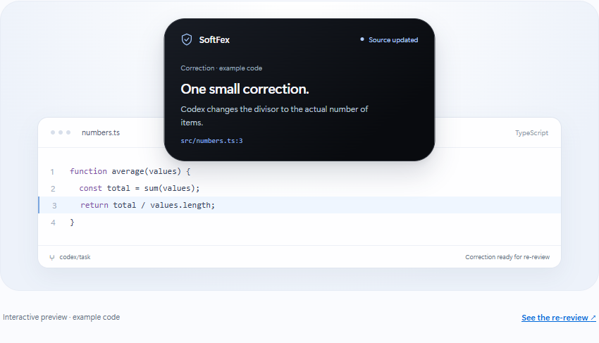

# SoftFex AI

**A second look before you ship.**

A small Windows desktop island that independently reviews your Codex changes with Claude. Inspect potential issues, copy a correction prompt, and review the fix.

[Website](https://softfex-ai-landing.vercel.app) · [Download Windows beta](https://github.com/kais-aljammal/SoftFex-AI/releases/download/v0.1.0-beta.1/SoftFex-AI-0.1.0-windows-x64.zip) · [Release notes](https://github.com/kais-aljammal/SoftFex-AI/releases/tag/v0.1.0-beta.1)

[](https://softfex-ai-landing.vercel.app)

*Website illustration, not a screenshot of the Windows app.*

## Get started

1. **Download** the Windows x64 ZIP above.
2. Right-click it → **Extract All**. Keep all extracted files together.
3. Open **SoftFex AI.exe**, then click the black island at the top of your screen.
4. Click **Configure Anthropic key** and enter your key in the masked terminal prompt.
5. **Choose project folder** → **Review settings** → **Enable AI review** → **Review Now**.

Bring your own Anthropic API key with credits. No installer, Node.js or Python is needed just to open the app. Voice is optional: configure Deepgram or use system voice. VS Code is needed for **Open in VS Code**.

## Review, fix, repeat

Open a finding → inspect the evidence → **Copy fix prompt** → give it to Codex → **Review Again**.



*Illustrative correction awaiting re-review.*

## Codex completion integration

For automatic reviews, install **Node.js 24+**, **Python 3.11+** and an authenticated **Codex CLI**. Open SoftFex, select your project, then run this in PowerShell with the same project path:

```powershell
node "$env:APPDATA\SoftFex AI\runtime\scripts\start-codex.cjs" -C "C:\path\to\your\project"
```

Global Codex/Coucou settings stay unchanged. Existing Codex desktop chats are not connected automatically. You can always use **Review Now** instead.

## Develop locally

```powershell
npm ci
npm run setup:key
npm run build
npm start
```

Run `npm test` for unit tests. Optional Deepgram setup: `npm run setup:voice`. From the repository, connect Codex with:

```powershell
node scripts/start-codex.cjs -C "C:\path\to\your\project"
```

## Beta notes

- Unsigned Windows x64 beta; see release notes for known limitations.
- Claude Sonnet 5.5 plus local checks. Reviews are limited to 12 source files and can miss issues; SoftFex does not run your tests or apply fixes.
- API keys are handled only by Electron main. AI review sends filtered source/context after consent; secret filtering is best-effort. Never commit `.env`.
- Beta 1 opens the finding file and line. The latest source also opens its project workspace; sidebar reveal remains a manual check.
